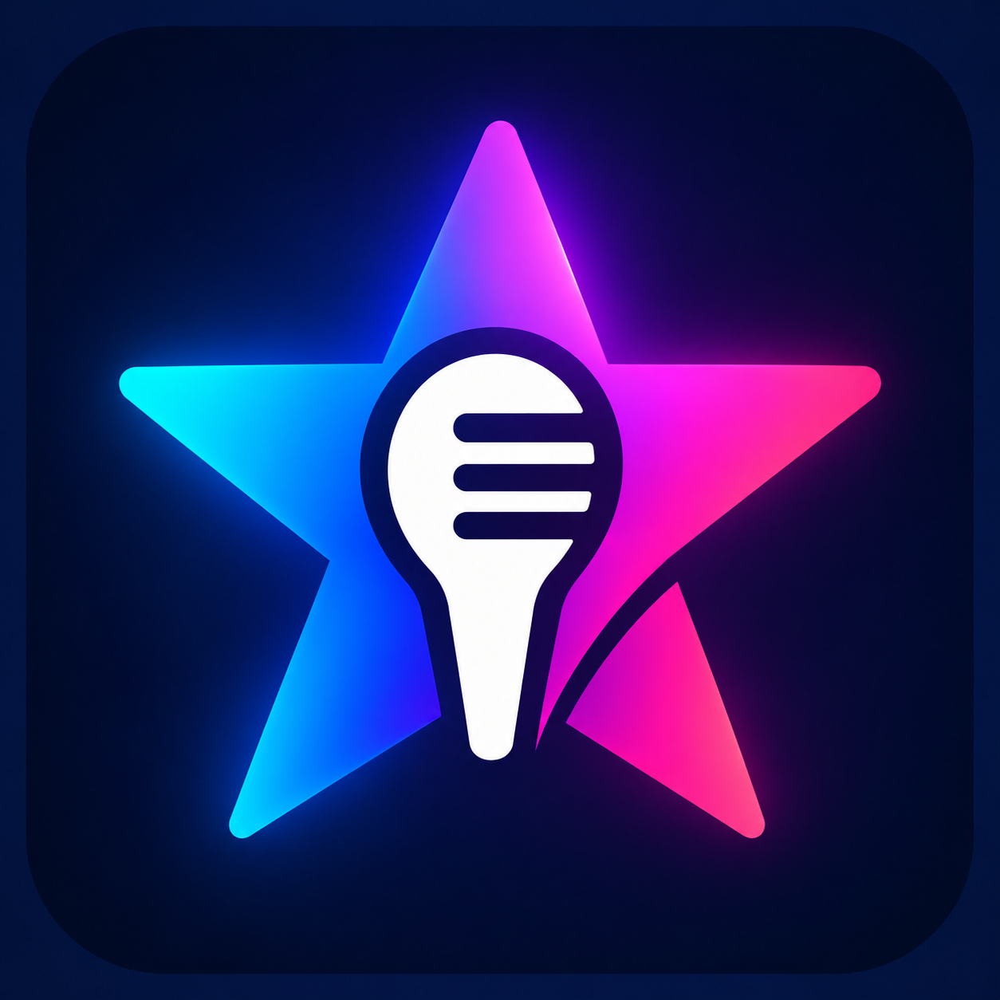
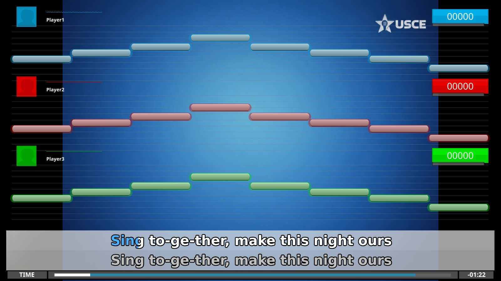
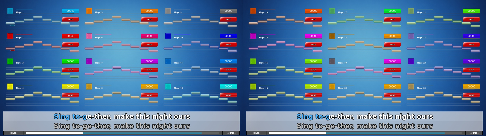

# UltraStar Community Edition

**Your music. Your stage. Your karaoke night.**

USCE is a free, open-source karaoke game for **Windows, macOS and Linux**.
Follow the lyrics, match the notes and see how your singing scores.
Sing solo, challenge friends or get everyone involved in a party game.

**[Getting started](docs/getting-started.md)** ·
**[Help and ideas](https://github.com/UltraStar-CE/USCE/discussions)** ·
**[Releases](https://github.com/UltraStar-CE/USCE/releases)**

## Play your way

| Sing together | Make it yours | Bring your collection |
| --- | --- | --- |
| Solo singing, duets and party modes, with support for up to 24 players. | Choose a theme, change the look and adjust the settings to suit your karaoke night. | Use UltraStar-format songs, with lyrics, pitch notes and optional video backgrounds. |

Bring everyone into the game

Choose a small group or a larger party. Layouts adapt to the number of players.

## Start singing

Our first USCE release is in preparation. Downloads will appear on the
[releases page](https://github.com/UltraStar-CE/USCE/releases) after testing.
You can already [build the game from source](COMPILING.md).

1. Connect a microphone and select it in the game's **Record** settings.
2. Add your UltraStar-format songs. Song collections are separate from the game.
3. Choose a song and sing!

Advanced file settings are listed in the [configuration reference](docs/config.ini.md).

## Shape what comes next

We build USCE around community ideas, with room for new features and experiments.
Configurable additions let you try something new or keep the experience you enjoy.

[Ask a question or suggest an idea](https://github.com/UltraStar-CE/USCE/discussions),
[report a problem](https://github.com/UltraStar-CE/USCE/issues), or
[help with testing, translations, themes and code](CONTRIBUTING.md).
Our [governance](GOVERNANCE.md) and [code of conduct](CODE_OF_CONDUCT.md)
explain how we work together.

## Credits

USCE builds on [UltraStar Deluxe](https://github.com/UltraStar-Deluxe/USDX),
which derives from UltraStar by corvus5. Thank you to everyone whose work makes
this game possible. See [COPYRIGHT.txt](COPYRIGHT.txt) and the Git history for
authorship, and [LICENSE](LICENSE) for the GPL license. Third-party libraries
and assets retain their own notices.
