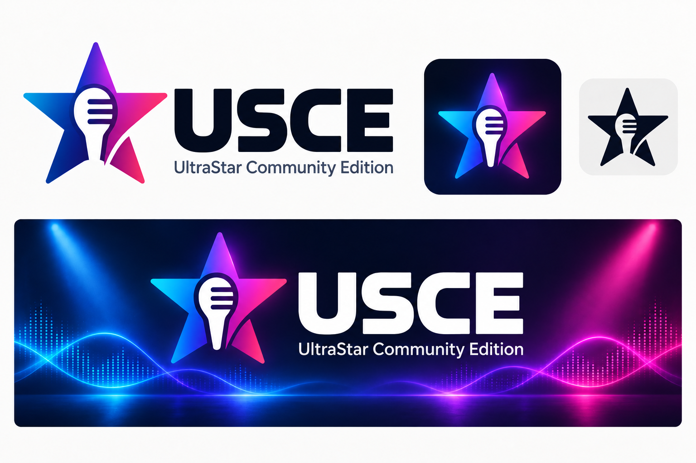

# USCE visual identity

Our identity combines a star and microphone with cyan, violet and magenta stage
colors. **USCE** expands to **UltraStar Community Edition**. The graphics focus
on singing and shared play, with abstract light and sound waves.

## Artwork

- `usce-logo-horizontal.png`: transparent dark wordmark for light backgrounds.
- `usce-app-icon.png`: square application and organization avatar artwork.
- `usce-social-banner.png`: repository and announcement artwork.
- `usce-identity-concept.png`: presentation board showing the visual direction.

We use the square star and microphone for the GitHub organization profile.
Application icons, installer artwork and menu backgrounds use the same identity.
[BRANDING.md](../BRANDING.md) describes platform assets and compatible data paths.

The horizontal logo suits light surfaces; the banner carries a light wordmark
for dark surfaces. Clear space and the original proportions keep the mark
recognizable. Supporting artwork uses abstract stage lighting.

The raster artwork was generated with OpenAI image generation and visually
reviewed. Prompts are recorded in `generation-prompts.txt`. The concept board presents the visual direction; the packaged assets use the
recorded raster sources. Existing upstream creator,
copyright and license notices remain in the project.

The missing-song-cover fallback in `game/covers/NoCover.jpg` is a JPEG export
of `usce-app-icon.png`, using the same square star-and-microphone artwork.
