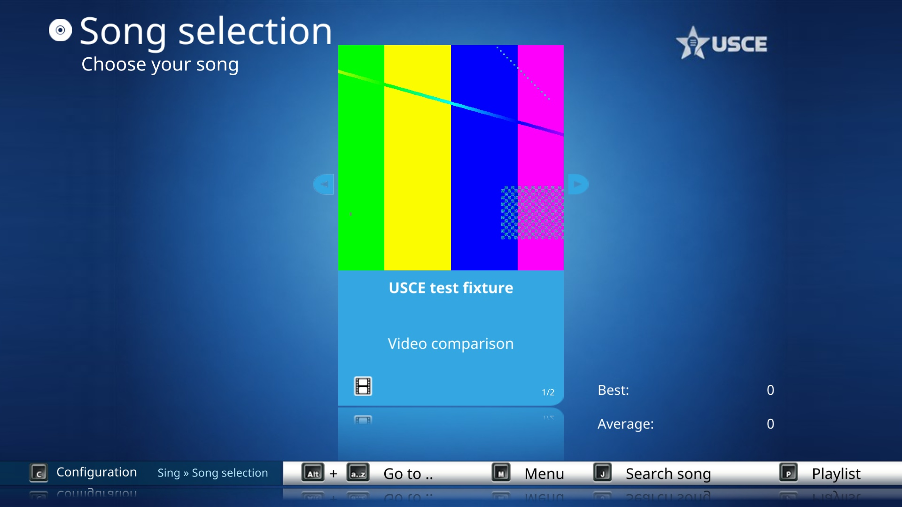
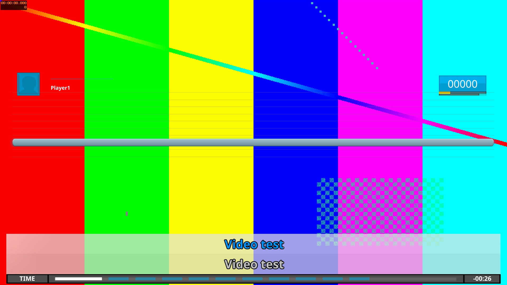
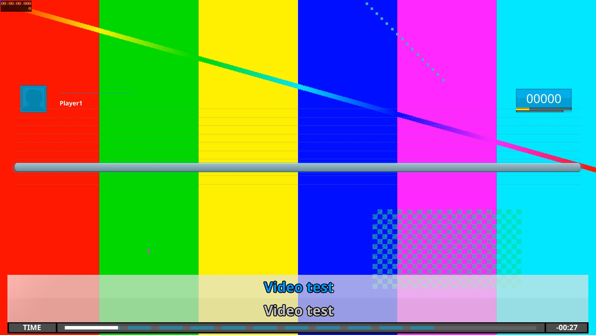

# Local MPV validation evidence

Ubuntu 26.04.1 x86-64, Intel Core i7-8550U, Intel UHD Graphics 620/i915, Mesa 26.0.8, FFmpeg 8.0, libmpv 0.41.0. Main baseline: 0c6a94fe52971a59c7bd82d0efe6f82d3be07cdc.

## Playback samples

CPU-seconds over approximately 60 wall-seconds; 1920x1080 game window with 60 fps cap. One player, no assigned microphone. Independent configs and score files. All 60 focus checks were valid for every sample.

| Input | Main/FFmpeg | MPV software | MPV auto | Auto decoder |
|---|---:|---:|---:|---|
| H.264/x264 High 1080p30 | 51.39 | 32.39 | 31.30 | vaapi-copy |
| AV1 Main 1080p (~24 fps) | 58.98 | 45.44 | 45.56 | software |
| HEVC/x265 Main 720p25 | 19.77 | 13.90 | 10.55 | vaapi-copy |

Mean RSS in MiB:

| Input | Main/FFmpeg | MPV software | MPV auto |
|---|---:|---:|---:|
| H.264/x264 | 307.7 | 452.4 | 463.8 |
| AV1 | 299.6 | 464.7 | 487.9 |
| HEVC/x265 | 276.0 | 464.3 | 469.5 |

Single sequential samples, not randomized or repeated. Samples overlap but are not aligned to exactly identical media timestamps. Different inputs and native resolutions across codecs prevent a codec-to-codec conclusion. CPU includes the whole game. No achieved-fps, frame-time, dropped-frame, microphone or singing-accuracy measurements. No Windows/macOS/Pi validation. Both MPV modes used the MPV provider without FFmpeg-provider fallback. Auto AV1 logged unsupported hardware decoding and continued in software.

## Screenshot provenance and limits

The screenshots below were captured from the actual native renderer through USCE's framebuffer screenshot function. A dedicated local test harness called the normal display/screen APIs to enter song selection, scroll to start preview, dismiss informational/missing-microphone popups and enter singing. Capture-only hooks were not added to production source. Both runs used the same pinned Modern theme and the same generated 1920x1080 H.264 static-pattern video. The synthetic pattern was generated with FFmpeg testsrc2 and repeated for 30 seconds, with silent audio and a small generated chart. No original song-library video, artwork or music is published here. Existing game/theme artwork retains its original licensing.

The captures support matching orientation, cropping, video placement and UI layout. Color conversion differences are visible in the pattern, so they do not prove RGB/pixel equality. Color-matrix/range handling needs review. Small UI timing differences are expected between captures. No image content was retouched or composited.

| Screen | Main / FFmpeg | MPV |
|---|---|---|
| Song video preview |  |  |
| Singing |  |  |
