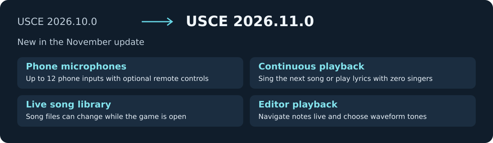
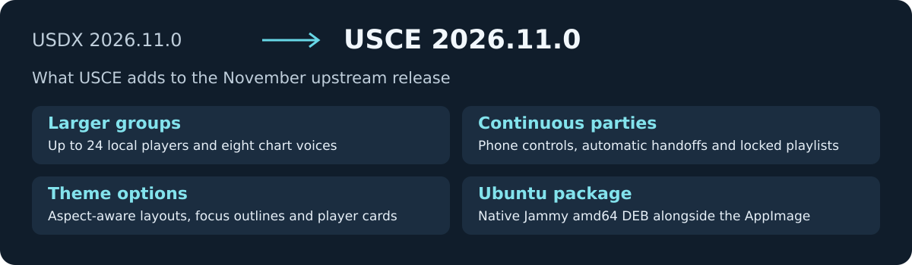

USCE 2026.11.0 incorporates the stable [UltraStar Deluxe 2026.11.0 release](https://github.com/UltraStar-Deluxe/USDX/releases/tag/v2026.11.0). Phone microphones, continuous playback, live song-library updates and new editor sounds are the biggest additions this month.

## Changes since USCE 2026.10.0

### Singing and parties

- **Phone microphones and remote controls.** Connect up to 12 phone inputs through the optional native relay client. Browse songs, control playback and run continuous Party queues from a phone. Remote support starts off, and USCE handles pitch detection, playback and scoring on the host. [#168](https://github.com/UltraStar-CE/USCE/pull/168), [#319](https://github.com/UltraStar-CE/USCE/pull/319), [#320](https://github.com/UltraStar-CE/USCE/pull/320)
- **Continuous playback.** Start from normal song selection, carry the group into the next song, or choose zero players for lyrics-only playback. Configure when results and highscores appear. Locked playlist sessions repeat and take the same display and timing settings from the command line. [#135](https://github.com/UltraStar-CE/USCE/pull/135), [#150](https://github.com/UltraStar-CE/USCE/pull/150), [#225](https://github.com/UltraStar-CE/USCE/pull/225)
- **Multipart charts.** Songs can have up to eight chart voices. Pick voices per player and edit or save multipart charts in the full editor. This chart limit is separate from the local and remote player limits. [#142](https://github.com/UltraStar-CE/USCE/pull/142), [#143](https://github.com/UltraStar-CE/USCE/pull/143), [#145](https://github.com/UltraStar-CE/USCE/pull/145)
- **Microphone setup.** Avatar borders show input activity. The host can change the player count regardless of connected microphones, and the choice sticks until an explicit remote count update. [#325](https://github.com/UltraStar-CE/USCE/pull/325), [#354](https://github.com/UltraStar-CE/USCE/pull/354)
- **Scoring and results.** Save scores after trailing freestyle lines across assigned voices, preserve earned points when seeking forward, and account for per-player delay before the first scored beat. The highscore screen can rank all difficulties together, labels each row's difficulty, and falls back to that view when player one's difficulty has no entries. [#132](https://github.com/UltraStar-CE/USCE/pull/132), [#181](https://github.com/UltraStar-CE/USCE/pull/181), [#219](https://github.com/UltraStar-CE/USCE/pull/219), [#243](https://github.com/UltraStar-CE/USCE/pull/243), [#347](https://github.com/UltraStar-CE/USCE/pull/347)
- **Singing display.** Optional pitch traces in the gaps between notes, beat-assist clicks, and countdowns during instrumental gaps help singers stay on track. [#159](https://github.com/UltraStar-CE/USCE/pull/159), [#223](https://github.com/UltraStar-CE/USCE/pull/223), [#260](https://github.com/UltraStar-CE/USCE/pull/260)

### Library, editor and appearance

- **Live library updates.** Adding, moving or removing song files updates the song list. The viewport keeps its place where possible and notifications report additions and removals. [#315](https://github.com/UltraStar-CE/USCE/pull/315), [#336](https://github.com/UltraStar-CE/USCE/pull/336), [#338](https://github.com/UltraStar-CE/USCE/pull/338)
- **Song selection.** Combine filters with counted suggestions and save them using the pin beside the lock. Folder cards and folder filters have separate settings. Modern and Classic keyboard modes are available. [#147](https://github.com/UltraStar-CE/USCE/pull/147), [#232](https://github.com/UltraStar-CE/USCE/pull/232), [#234](https://github.com/UltraStar-CE/USCE/pull/234), [#262](https://github.com/UltraStar-CE/USCE/pull/262), [#321](https://github.com/UltraStar-CE/USCE/pull/321)
- **Editor playback.** Adjust BPM and GAP during playback, move between notes without interrupting the preview, and switch lines to stop it. Change an entire line's note type with Shift+F/G. [#332](https://github.com/UltraStar-CE/USCE/pull/332), [#346](https://github.com/UltraStar-CE/USCE/pull/346), [#353](https://github.com/UltraStar-CE/USCE/pull/353)
- **Note and click sounds.** Choose Organ, Triangle, Piano, Sine, Square or Sawtooth for note previews and Drumstick or Hi-hat for clicks. Organ and Drumstick retain the previous sound. The piano is synthesized without recordings. [#352](https://github.com/UltraStar-CE/USCE/pull/352)
- **Themes and layouts.** Theme backgrounds stay in place during zoom transitions and videos can continue across menus. New optional controls cover focus outlines, rounded covers and avatars, theme fonts, player cards and singing headers. Statistics detail pages and highscores can use two columns when space allows. [#184](https://github.com/UltraStar-CE/USCE/pull/184), [#249](https://github.com/UltraStar-CE/USCE/pull/249), [#265](https://github.com/UltraStar-CE/USCE/pull/265), [#267](https://github.com/UltraStar-CE/USCE/pull/267), [#283](https://github.com/UltraStar-CE/USCE/pull/283), [#285](https://github.com/UltraStar-CE/USCE/pull/285), [#297](https://github.com/UltraStar-CE/USCE/pull/297), [#314](https://github.com/UltraStar-CE/USCE/pull/314)
- **Language and media fixes.** Add Esperanto, extend Spanish translations and fall back silently to English when localized help cannot load. Video decoding can run in the background, and seeking flushes old queued audio. [#27](https://github.com/UltraStar-CE/USCE/pull/27), [#302](https://github.com/UltraStar-CE/USCE/pull/302), [#303](https://github.com/UltraStar-CE/USCE/pull/303), [#306](https://github.com/UltraStar-CE/USCE/pull/306), [#328](https://github.com/UltraStar-CE/USCE/pull/328), [#348](https://github.com/UltraStar-CE/USCE/pull/348)

### Packages and compatibility

- The new native Ubuntu package targets **Ubuntu 22.04 amd64**. Install the download with `sudo apt install ./USCE-linux-deb-2026.11.0.deb`. This first DEB omits webcam and projectM support. AppImage, Windows installer and portable ZIP, and Intel and Apple silicon macOS packages remain available. [#313](https://github.com/UltraStar-CE/USCE/pull/313)
- On Windows, the package check verifies that bundled DLLs resolve without development search paths. Intel Windows desktop OpenGL 3 contexts automatically use the alternate buffer upload path. [#292](https://github.com/UltraStar-CE/USCE/pull/292), [#327](https://github.com/UltraStar-CE/USCE/pull/327)
- The separate Jukebox has been removed. For playback without singing, use continuous mode with zero players. [#80](https://github.com/UltraStar-CE/USCE/pull/80), [#135](https://github.com/UltraStar-CE/USCE/pull/135)

## Changes compared with USDX 2026.11.0

### USCE additions

- **Run a longer session.** Continuous playback, zero-player lyrics mode, locked playlists, remote playback controls and phone microphones. Local layouts support up to 24 players, with per-player setup and microphone feedback. [#76](https://github.com/UltraStar-CE/USCE/pull/76), [#135](https://github.com/UltraStar-CE/USCE/pull/135), [#168](https://github.com/UltraStar-CE/USCE/pull/168), [#225](https://github.com/UltraStar-CE/USCE/pull/225)
- **Find, edit and sing more charts.** Eight chart voices, searchable and saved filters, live library updates, a waveform synthesizer, shared beat timing and a difficulty-labeled highscore view. [#78](https://github.com/UltraStar-CE/USCE/pull/78), [#143](https://github.com/UltraStar-CE/USCE/pull/143), [#234](https://github.com/UltraStar-CE/USCE/pull/234), [#315](https://github.com/UltraStar-CE/USCE/pull/315), [#347](https://github.com/UltraStar-CE/USCE/pull/347), [#352](https://github.com/UltraStar-CE/USCE/pull/352)
- **Adapt the interface.** Resizable windows, aspect-aware layouts and theme-defined artwork and controls. The packages include the pinned Themes snapshot and preserve existing artwork credits. [#83](https://github.com/UltraStar-CE/USCE/pull/83), [#270](https://github.com/UltraStar-CE/USCE/pull/270), [UltraStar-CE/Themes#29](https://github.com/UltraStar-CE/Themes/pull/29)
- **Install on Ubuntu.** A native Jammy amd64 DEB is available alongside the AppImage. [#313](https://github.com/UltraStar-CE/USCE/pull/313)

### Coverage of upstream changes

| USDX change | In USCE |
| --- | --- |
| [UltraStar-Deluxe/USDX#1467](https://github.com/UltraStar-Deluxe/USDX/pull/1467), scores with a trailing freestyle line | Adapted the completion logic to assigned voices, scoring weights and medleys. [#181](https://github.com/UltraStar-CE/USCE/pull/181), [#243](https://github.com/UltraStar-CE/USCE/pull/243), [#245](https://github.com/UltraStar-CE/USCE/pull/245) |
| [UltraStar-Deluxe/USDX#1460](https://github.com/UltraStar-Deluxe/USDX/pull/1460), Linux and macOS sound effects | Sound effects restart explicitly without restarting the synth. [#155](https://github.com/UltraStar-CE/USCE/pull/155), [#263](https://github.com/UltraStar-CE/USCE/pull/263) |
| [UltraStar-Deluxe/USDX#1463](https://github.com/UltraStar-Deluxe/USDX/pull/1463), AnyASCII range checks in Chinese song metadata | Retained USCE's native-width index fix, tested with the reported characters and long strings. [#152](https://github.com/UltraStar-CE/USCE/pull/152), [#345](https://github.com/UltraStar-CE/USCE/pull/345) |
| [UltraStar-Deluxe/USDX#1455](https://github.com/UltraStar-Deluxe/USDX/pull/1455), [UltraStar-Deluxe/USDX#1454](https://github.com/UltraStar-Deluxe/USDX/pull/1454), [UltraStar-Deluxe/USDX#1461](https://github.com/UltraStar-Deluxe/USDX/pull/1461), platform build changes and DLLs | Incorporated the macOS linking check and Windows autotools changes, plus the dependency refresh. [#19](https://github.com/UltraStar-CE/USCE/pull/19), [#149](https://github.com/UltraStar-CE/USCE/pull/149), [#151](https://github.com/UltraStar-CE/USCE/pull/151) |
| [UltraStar-Deluxe/USDX#1457](https://github.com/UltraStar-Deluxe/USDX/pull/1457), duplicate PrintScreen captures | Includes the Windows hotkey fix. [#113](https://github.com/UltraStar-CE/USCE/pull/113), [#180](https://github.com/UltraStar-CE/USCE/pull/180) |
| [UltraStar-Deluxe/USDX#1464](https://github.com/UltraStar-Deluxe/USDX/pull/1464), issue forms | Includes the updated issue forms with the USCE reporter-testing question. [#263](https://github.com/UltraStar-CE/USCE/pull/263) |

Thanks to all contributors to USCE, Themes and UltraStar Deluxe. The linked PRs credit the original authors and document adaptations.
