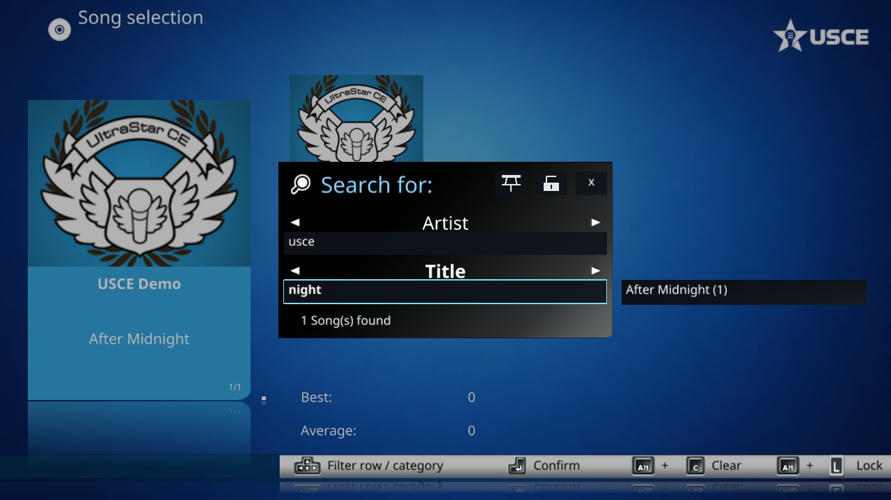
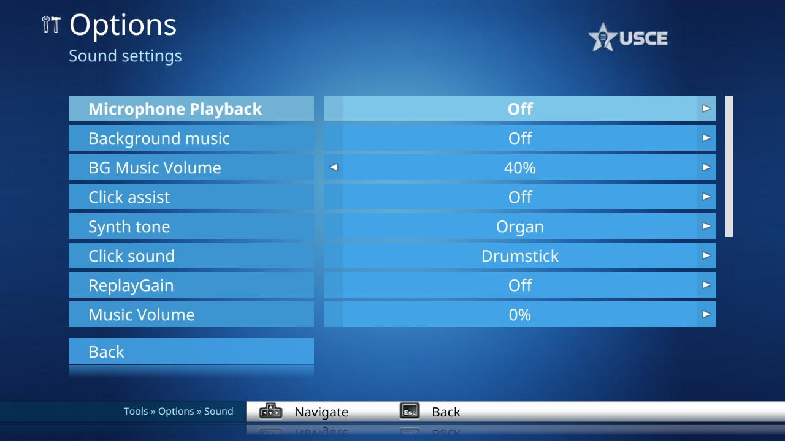
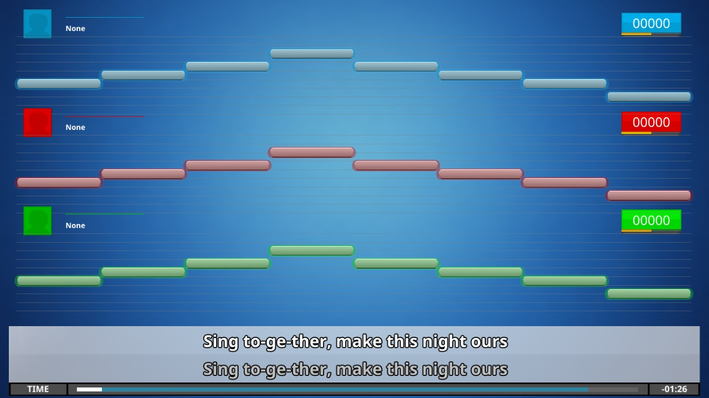

USCE 2026.11.0 adds phone microphones, continuous playback, live song-library updates and new editor tools. USCE had already fixed all three bugs highlighted in [UltraStar Deluxe 2026.11.0](https://github.com/UltraStar-Deluxe/USDX/releases/tag/v2026.11.0).

## Highlights

### Changes since USCE 2026.10.0

- **Phone microphones and remote controls.** Connect up to 12 phone inputs through the optional native relay client. Browse songs, control playback and run continuous Party queues from a phone. Remote support starts off, and USCE handles pitch detection, playback and scoring on the host. [#168](https://github.com/UltraStar-CE/USCE/pull/168), [#319](https://github.com/UltraStar-CE/USCE/pull/319), [#320](https://github.com/UltraStar-CE/USCE/pull/320)
- **Continuous playback.** Start from normal song selection, carry the group into the next song, or choose zero players for lyrics-only playback. Configure when results and highscores appear. Locked playlist sessions repeat and take the same display and timing settings from the command line. [#135](https://github.com/UltraStar-CE/USCE/pull/135), [#150](https://github.com/UltraStar-CE/USCE/pull/150), [#225](https://github.com/UltraStar-CE/USCE/pull/225)
- **Live library updates.** Adding, moving or removing song files updates the song list. The viewport keeps its place where possible and notifications report additions and removals. [#315](https://github.com/UltraStar-CE/USCE/pull/315), [#336](https://github.com/UltraStar-CE/USCE/pull/336), [#338](https://github.com/UltraStar-CE/USCE/pull/338)
- **Song selection.** Combine filters with counted suggestions and save them using the pin beside the lock. Folder cards and folder filters have separate settings. Modern and Classic keyboard modes are available. [#147](https://github.com/UltraStar-CE/USCE/pull/147), [#232](https://github.com/UltraStar-CE/USCE/pull/232), [#234](https://github.com/UltraStar-CE/USCE/pull/234), [#262](https://github.com/UltraStar-CE/USCE/pull/262), [#321](https://github.com/UltraStar-CE/USCE/pull/321)

- **Editor playback.** Adjust BPM and GAP during playback, move between notes without interrupting the preview, and switch lines to stop it. Change an entire line's note type with Shift+F/G. [#332](https://github.com/UltraStar-CE/USCE/pull/332), [#346](https://github.com/UltraStar-CE/USCE/pull/346), [#353](https://github.com/UltraStar-CE/USCE/pull/353)
- **Note and click sounds.** Choose Organ, Triangle, Piano, Sine, Square or Sawtooth for note previews and Drumstick or Hi-hat for clicks. Organ and Drumstick retain the previous sound. The piano is synthesized without recordings. [#352](https://github.com/UltraStar-CE/USCE/pull/352)

### Changes compared with USDX 2026.11.0

- **Sing with larger groups.** Local layouts support up to 24 players. Player setup shows microphone activity on avatar borders. Charts can have up to eight voices, which players can pick individually and edit in the full song editor. [#76](https://github.com/UltraStar-CE/USCE/pull/76), [#142](https://github.com/UltraStar-CE/USCE/pull/142), [#143](https://github.com/UltraStar-CE/USCE/pull/143), [#145](https://github.com/UltraStar-CE/USCE/pull/145), [#325](https://github.com/UltraStar-CE/USCE/pull/325)
- **Stay on beat and compare scores.** Optional pitch traces fill the gaps between notes, and instrumental countdowns and beat clicks help with re-entry. The highscore screen can rank all difficulties together, labels each row's difficulty and falls back to that view when player one's difficulty has no entries. [#159](https://github.com/UltraStar-CE/USCE/pull/159), [#223](https://github.com/UltraStar-CE/USCE/pull/223), [#260](https://github.com/UltraStar-CE/USCE/pull/260), [#347](https://github.com/UltraStar-CE/USCE/pull/347)
- **Make better use of the screen.** Windows resize with aspect-aware layouts. Statistics and highscores use two columns where space allows. Themes can customize fonts, rounded covers and avatars, focus outlines, player cards and singing headers. Backgrounds stay in place during zoom transitions and videos can continue across menus. [#83](https://github.com/UltraStar-CE/USCE/pull/83), [#184](https://github.com/UltraStar-CE/USCE/pull/184), [#249](https://github.com/UltraStar-CE/USCE/pull/249), [#265](https://github.com/UltraStar-CE/USCE/pull/265), [#267](https://github.com/UltraStar-CE/USCE/pull/267), [#283](https://github.com/UltraStar-CE/USCE/pull/283), [#285](https://github.com/UltraStar-CE/USCE/pull/285), [#297](https://github.com/UltraStar-CE/USCE/pull/297), [#314](https://github.com/UltraStar-CE/USCE/pull/314)

For lyrics-only playback, use continuous mode with zero players. This replaces the separate Jukebox. [#80](https://github.com/UltraStar-CE/USCE/pull/80), [#135](https://github.com/UltraStar-CE/USCE/pull/135)

## Technical improvements

- **Ubuntu 22.04 amd64 now has a native DEB.** Install it with `sudo apt install ./USCE-linux-deb-2026.11.0.deb`. This first package omits webcam and projectM support. The AppImage, Windows installer and portable ZIP, and Intel and Apple silicon macOS packages remain available. [#313](https://github.com/UltraStar-CE/USCE/pull/313)
- **Package checks are stricter.** Windows checks bundled DLLs without development search paths. The portable ZIP includes USCE's license and credits. All packages bundle the same ten themes and record the exact Themes revision. [#144](https://github.com/UltraStar-CE/USCE/pull/144), [#270](https://github.com/UltraStar-CE/USCE/pull/270), [#292](https://github.com/UltraStar-CE/USCE/pull/292), [UltraStar-CE/Themes#29](https://github.com/UltraStar-CE/Themes/pull/29)
- **Keep current with USDX builds and reporting.** USCE includes the macOS link check, Windows autotools changes and refreshed DLLs from UltraStar-Deluxe/USDX#1455, UltraStar-Deluxe/USDX#1454 and UltraStar-Deluxe/USDX#1461. It also incorporates the issue forms from UltraStar-Deluxe/USDX#1464 and keeps the optional reporter-testing question. [#19](https://github.com/UltraStar-CE/USCE/pull/19), [#149](https://github.com/UltraStar-CE/USCE/pull/149), [#151](https://github.com/UltraStar-CE/USCE/pull/151), [#263](https://github.com/UltraStar-CE/USCE/pull/263)
- **Rendering and decoding.** Background video decoding reduces stalls. Intel Windows desktop OpenGL 3 contexts select an alternate buffer upload path automatically. [#303](https://github.com/UltraStar-CE/USCE/pull/303), [#327](https://github.com/UltraStar-CE/USCE/pull/327)
- **Translations.** Esperanto is available and Spanish has broader coverage, including the sound volume options. [#27](https://github.com/UltraStar-CE/USCE/pull/27), [#302](https://github.com/UltraStar-CE/USCE/pull/302), [#348](https://github.com/UltraStar-CE/USCE/pull/348)

## Bugfixes over USDX

**Already fixed in USCE before the November USDX release**

- **Scores lost after a freestyle ending.** USCE handles song completion across assigned voices, configurable scoring weights and medleys. Covers [UltraStar-Deluxe/USDX#1467](https://github.com/UltraStar-Deluxe/USDX/pull/1467). [#181](https://github.com/UltraStar-CE/USCE/pull/181), [#243](https://github.com/UltraStar-CE/USCE/pull/243)
- **Sound effects failing to replay on Linux and macOS.** USCE restarts effects explicitly and keeps the synth playing. Covers [UltraStar-Deluxe/USDX#1460](https://github.com/UltraStar-Deluxe/USDX/pull/1460). [#155](https://github.com/UltraStar-CE/USCE/pull/155)
- **Songs missing with some Chinese characters in their metadata.** USCE's AnyASCII fix uses native-width indices and was tested with the reported characters and long strings. Covers [UltraStar-Deluxe/USDX#1463](https://github.com/UltraStar-Deluxe/USDX/pull/1463). [#152](https://github.com/UltraStar-CE/USCE/pull/152)
- **Duplicate screenshots from PrintScreen on Windows.** USCE already included the hotkey correction from [UltraStar-Deluxe/USDX#1457](https://github.com/UltraStar-Deluxe/USDX/pull/1457). [#113](https://github.com/UltraStar-CE/USCE/pull/113), [#180](https://github.com/UltraStar-CE/USCE/pull/180)

**Other bugs fixed in USCE**

- Seeking flushes old queued audio, forward seeks preserve earned points, and negative microphone delays keep the opening scoring beats. [#132](https://github.com/UltraStar-CE/USCE/pull/132), [#219](https://github.com/UltraStar-CE/USCE/pull/219), [#328](https://github.com/UltraStar-CE/USCE/pull/328)
- Connected microphones no longer lock the local player count. The host's choice sticks until an explicit remote count update. [#354](https://github.com/UltraStar-CE/USCE/pull/354)
- Missing or malformed help translations fall back silently to English. [#306](https://github.com/UltraStar-CE/USCE/pull/306)

Thanks to the USCE, Themes and UltraStar Deluxe contributors. The linked PRs credit the original authors and document the adaptations.
